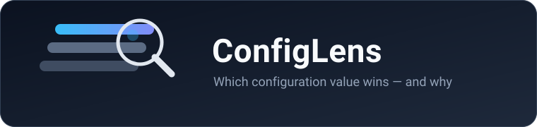

# ConfigLens

[Website & interactive demo](https://ob4cl.github.io/configlens/) · [Releases](https://github.com/ob4cl/configlens/releases) · [Documentation](docs/README.md)

**See which supported Claude Code or OpenCode setting wins — and why.**

ConfigLens is a small, local, read-only Rust CLI that traces a supported configuration key for
**Claude Code** and **OpenCode** across supported configuration sources, and shows the observed
winner — with the file, line and reason for each contribution, including the ones that lost.

Try it if conflicting user and project settings leave you unsure which file to edit. Instead of
reading each file and reconstructing precedence by hand, inspect one ordered trace, including
overridden definitions and the layers ConfigLens could not observe.

It never executes your configuration, never runs a client binary, opens no socket and accesses no
credential store. Configuration files may contain sensitive values, which are redacted unless an
adapter explicitly allowlists them.

> **Pre-release, `0.1.0-beta.3`.** A working prototype, not a finished product: both adapters are
> fixture-verified rather than runtime-conformant, and unreadable layers are reported as gaps instead
> of guessed. [Status](#status) says exactly what that means.

## Install

Prebuilt binaries are attached to every release. Three targets ship today:

| Platform | Release archive |
|---|---|
| Windows (x86-64) | `configlens-<tag>-x86_64-pc-windows-msvc.zip` |
| macOS (Apple Silicon) | `configlens-<tag>-aarch64-apple-darwin.tar.gz` |
| Linux (x86-64, glibc) | `configlens-<tag>-x86_64-unknown-linux-gnu.tar.gz` |

Each release carries a `SHA256SUMS` file; beta.2 and beta.3 also have a CycloneDX SBOM per target. The binaries are
**unsigned** and there is no installer or package manager; replace `<tag>` below with the release you
want (currently `v0.1.0-beta.3`).

### Verify the download

Linux and macOS:

```sh
tag=v0.1.0-beta.3
target=x86_64-unknown-linux-gnu              # or aarch64-apple-darwin
base=https://github.com/ob4cl/configlens/releases/download/$tag
curl -fLO "$base/configlens-$tag-$target.tar.gz"
curl -fLO "$base/SHA256SUMS"
grep "  configlens-$tag-$target.tar.gz\$" SHA256SUMS > CHECKSUM
sha256sum -c CHECKSUM                     # macOS: use shasum -a 256 -c CHECKSUM
tar xzf configlens-$tag-$target.tar.gz
./configlens-$tag-$target/configlens --version
```

Windows (PowerShell):

```powershell
$tag  = 'v0.1.0-beta.3'
$repo = 'ob4cl/configlens'
# With the GitHub CLI:
gh release download $tag --repo $repo --pattern '*windows-msvc.zip'
gh release download $tag --repo $repo --pattern 'SHA256SUMS'
# Without it: download both files from the release page in a browser.

$name     = "configlens-$tag-x86_64-pc-windows-msvc.zip"
$zip      = Get-Item $name
$entries  = @(Get-Content .\SHA256SUMS | Where-Object { $_.EndsWith("  $name") })
if ($entries.Count -ne 1) { throw 'Expected one matching checksum entry' }
$expected = ($entries[0] -split '\s+')[0]
$actual   = (Get-FileHash -Algorithm SHA256 $zip.FullName).Hash.ToLower()
if ($actual -ne $expected) { throw 'SHA256 mismatch - do not run this file' }
Expand-Archive $zip.FullName -DestinationPath unpacked
& ".\unpacked\configlens-$tag-x86_64-pc-windows-msvc\configlens.exe" --version
```

Expect `configlens 0.1.0-beta.3`. On macOS the archive is not notarized, so Gatekeeper warns on first
run: right-click → Open, or `xattr -d com.apple.quarantine <binary>`.

### Install from source

Any platform with Rust 1.85 or newer:

```sh
cargo install --locked --git https://github.com/ob4cl/configlens configlens
```

This follows the default branch, not the release archive. To reproduce the published beta source,
add `--tag v0.1.0-beta.3` to that command.

Or from a checkout: `cargo build --locked --release`, which leaves the binary at
`target/release/configlens`.

For a binary you intend to distribute, use `python3 scripts/build_release.py` instead (Python 3
required; on Windows use `python`). This remaps Rust source paths under your home and checkout to
neutral prefixes. Ordinary Cargo builds can embed local paths; remapping is best-effort, so inspect
the final artifact rather than treating it as a general secret scrubber.

**Not available yet:** macOS Intel, Linux arm64, crates.io, Homebrew, Scoop/winget. There is no
mandatory curl-to-shell installer, and nothing here contacts the network at run time.

## Your first command

```sh
configlens explain /model --client claude --client-version 2.1.296
```

That prints the observed winner for `model` with the file, line and reason for every contribution.
[A real terminal example](#a-real-terminal-example) shows the full output and how to read it.

## Help test the beta

Run the [isolated demo](#run-the-isolated-demo) first, then try one supported setting in a project
you control. Can you identify the winning source and understand any coverage gaps?

- [Report a bug or compatibility finding](https://github.com/ob4cl/configlens/issues/new?template=bug_report.yml).
  Include ConfigLens version, OS/architecture, client and exact client version, command, exit code,
  expected versus observed result, and a minimal **synthetic** reproduction. Unsupported versions
  are useful findings too; do not treat fixture verification as proof of live-client behaviour.
- If attaching output, generate a preview with
  `configlens support-report --client claude --client-version 2.1.296 --preview`
  (choose `--client opencode --client-version 1.18.35` for OpenCode). Read and sanitize it yourself
  before sharing: there is no upload, and redaction does not guarantee anonymity.
- For security or privacy concerns, follow [`SECURITY.md`](SECURITY.md), not a public configuration dump.

## The question this answers

You set a model, a permission, an MCP flag. The tool ignores it. You now have five plausible files,
an environment variable, a session flag and a managed policy that might all be involved — and the
tool just says "using the other one". ConfigLens answers the four questions that follow:

- **Which value won?** The observed winner among everything it could read.
- **Where did each value come from?** File, line and column for every contribution, in precedence
  order, including the definitions that were replaced or skipped.
- **Which file should I edit?** The winning source is named, so you edit the right one.
- **Can I paste this into an issue?** Reports redact protected values, and `--paths share`
  reduces identifying details; `configlens support-report --client claude --preview`
  builds a share-mode report for exactly this. Review the output and the privacy limitations below
  before sharing; a redacted report is not a guarantee of anonymity.

## Quick start (from source)

For a source checkout (prebuilt archives are also available above), build locally. No client needs to be installed, and no
network access is needed at run time.

```sh
cargo build --locked --release
./target/release/configlens --help
```

Prefer to install the binary into your `PATH` from the checkout:

```sh
cargo install --locked --path .
```

## Run the isolated demo

`demo/demo.sh` reads **no real configuration**. It creates a throwaway home and project under a
temporary directory, writes only obviously-fake values, clears the environment, and runs the CLI
against that sandbox. Nothing outside the temporary directory is written, and no network or client
subprocess is used.

```sh
cargo build --locked --release
./demo/demo.sh
```

## A real terminal example

Captured from the isolated demo above (synthetic values only). The long coverage line and the two
trailing `trust_unknown` diagnostics are elided — the tool prints every gap and every diagnostic.

The demo writes `{"model":"project-model"}` in `.claude/settings.json` and
`{"model":"local-model"}` in `.claude/settings.local.json`. The local project layer has higher
precedence for this supported scalar key, so it replaces the project definition:

```console
$ configlens explain /model --client claude --client-version 2.1.296
/model = "local-model" (observed)
Observed winner: $PROJECT/.claude/settings.local.json:1:12  "local-model"  observed_winner
Losers:
  "project-model"  $PROJECT/.claude/settings.json:2:12  replaced_by_later_layer
Rule: claude.scalar.layer-override
Coverage: partial — cc.managed.hkcu — registry_not_read (expected_unobservable); … (3 more gaps)
Support: fixture_verified; confidence: evidence_class:fixture_verified
Conclusion: "local-model" wins among the observed applicable sources; effective value withheld.
Next inspection:
  - supply the managed settings file with --input-context to include it
  - remote/MDM layers are not observable here; re-run where the managed source is readable
```

Read it as: the project file set `model` to `"project-model"`, a later layer replaced it with
`"local-model"`, and `"local-model"` is what ConfigLens observed to win. It deliberately does **not**
call that the runtime value, because a higher layer it cannot read might still change it — see
[bounded semantics](#what-wins-actually-means).

## Commands

```
configlens <command> [options]
```

| Command | Example | What it does |
|---|---|---|
| `clients` | `configlens clients` | List implemented adapters with their tested versions, the layers that are always incomplete, and the clients explicitly unsupported. |
| `scan` | `configlens scan --client claude` | Inventory candidate sources with applicability and readability, plus coverage gaps. No recursive crawl. |
| `explain` | `configlens explain /model --client claude --client-version 2.1.296` | Explain one RFC 6901 JSON Pointer: the ordered trace, the observed winner (or an unresolved result) and coverage gaps. |
| `doctor` | `configlens doctor --client opencode --format json --strict` | Parse / schema / applicability / coverage diagnostics. Never certifies a configuration as safe. |
| `snapshot` | `configlens snapshot --client claude --output before.json` | Write the redacted report JSON to an explicit path. Create-new by default; `--overwrite` to replace. |
| `diff` | `configlens diff before.json after.json` | Compare two reports from the same client and schema; protected values compare as `unknown_redacted`. |
| `schema` | `configlens schema --kind report` | Print the bundled report JSON Schema. No network. |
| `support-report` | `configlens support-report --client claude --preview` | Build a share-mode report for pasting into an issue. Always share mode (regardless of `--paths`). `--preview` prints it to stdout and writes nothing; `--output <PATH>` writes it (`0600` on Unix). There is no upload. |
| `completions` | `configlens completions --shell bash` | Print a shell completion script for `bash`, `zsh` or `fish`, generated from the live command tree. Nothing is written to disk. |

Run `configlens --help` (and `configlens <command> --help`) for the current, authoritative list — the
table above covers the core commands.

### Options

`--client <opencode|claude>` is required for resolution. Shared options:
`--cwd <PATH>` (default `.`), `--client-version <VERSION>` (a *claimed* version — ConfigLens never
reads a client binary), `--format text|json`, `--strict`, `--no-env`, `--input-context <PATH>`,
`--color auto|always|never`, `--paths local|share`, `--allow-read-root <PATH>` (repeatable),
`--project-root <PATH>`. In addition, a global `--quiet` (accepted on every subcommand, as
`configlens <cmd> --quiet`) suppresses **informational** stderr notes only — the snapshot
`wrote N bytes` line and the support-report write/`--preview` notes. Errors are always printed to
stderr, stdout stays machine-readable (JSON), and exit codes are unchanged. `snapshot` adds
`--output`/`--overwrite`; `doctor` adds
`--fail-on warning|error`; `support-report` takes `--preview` or `--output <PATH>`; supplying neither is a usage
error (exit `2`), and if both are given `--preview` wins and nothing is written; `completions` takes `--shell bash|zsh|fish`.

### Exit codes

| Code | Meaning |
|---|---|
| `0` | Report produced. Non-fatal findings are allowed. |
| `1` | `doctor` findings at or above `--fail-on` (default `error`). |
| `2` | Usage error or incompatible input/report. |
| `3` | Requested key/client semantics unsupported, or `--strict` found an incomplete context. |
| `4` | A required file was inaccessible, malformed or over a resource limit. |

When several apply, the priority is `2 → 4 → 3 → 1 → 0`.

## What "wins" actually means

Three terms carry the weight in every report:

- **observed winner** — the highest-precedence definition among the sources ConfigLens could read.
- **fixture_verified** — the rule was checked against this project's fixtures and upstream
  documentation, **not** against a running client.
- **coverage gap** — a source that exists but could not be read, so the effective value is withheld.

ConfigLens is a static analyser of the inputs it can read. It does not inspect a running session and
it never assumes an unreadable layer is absent. That has three visible consequences:

- **Observed, not effective.** When a higher-priority layer exists but is unobservable (a
  server-managed policy, an MDM/registry setting, OpenCode remote defaults) — or the project trust
  state is unknown — the result is marked `partial`, the winner is labelled an *observed* winner,
  and the effective value is **withheld** alongside the list of coverage gaps.
- **Inventory, not guessing.** An unknown key is preserved as opaque inventory and never given an
  invented merge rule. An unknown or untested client version is reported provisionally; `--strict`
  then exits `3`.
- **Provenance, not authorization.** For Claude permission lists, ConfigLens shows how list entries
  combine and prints an explicit caveat that this is **not** an authorization decision.

So exit code `0` means "a report was produced", not "this is the value your tool will use".

## Compatibility

Two bounded adapters ship today. Both are `fixture_verified` at most — verified against the
project's own fixtures and the current upstream documentation, **not** against the upstream loaders,
so no rule claims `upstream_conformance_verified`. Support states run
`inventory_only < documented < fixture_verified < upstream_conformance_verified`.

| Client | Adapter revision | Tested / documented version | Max support | Always-incomplete layers |
|---|---|---|---|---|
| OpenCode | 0.1.0 | 1.18.35 tested / 1.19.0 documented | `fixture_verified` | remote defaults, `.opencode` directories, macOS managed preferences |
| Claude Code | 0.1.0 | 2.1.296 | `fixture_verified` | MDM policy store, server-managed settings, HKCU registry, managed-file-absent |

Per-key detail, evidence URLs, retrieval dates and rule→test IDs live in the adapters' registries:
[`compatibility/opencode/registry.md`](compatibility/opencode/registry.md) and
[`compatibility/claude/registry.md`](compatibility/claude/registry.md).

OpenCode's `@opencode/cli` **2.x** line is a separate beta with a *different* documented merge model
(directory walk to the filesystem root; every `.opencode` config overriding every direct config). It
is **not implemented**; a claimed version outside the supported sets is reported `unsupported` rather
than resolved on a guess. See the adapter registry.

These clients are **not implemented** and are labelled `unsupported` — no compatibility claim is
made from shared file names: Codex and Gemini (0.2 backlog), Aider (backlog), and Cursor, Copilot
CLI, Cline, Roo and Hermes (not investigated). Run `configlens clients` for the current matrix.

## Privacy and caveats

- **Offline and read-only.** No network, no subprocess and no client-binary execution; a test scans
  `src/` to keep it that way. `$schema` references are never fetched.
- **Redact unless allowlisted.** Only the redaction projection produces reportable values; secrets
  appear as `{"redacted": true, "reason": "..."}`.
- **Two path modes.** `--paths local` (default) shows config locations and key names so you can
  diagnose; `--paths share` pseudonymizes paths, replaces unknown key names with opaque IDs, and
  strips URL userinfo, query and fragment.
- **Snapshots.** Written create-new, atomically, with `0600` owner-only permissions on Unix.
  On Windows there is no `0600` equivalent: the snapshot is written as a same-directory temporary
  file and then renamed, so it **inherits the ACL of the destination folder** — ConfigLens cannot
  tighten it. The report states this (`redaction.snapshot_acl = "not_implemented"`) rather than
  claiming a protection that does not exist.
- **Known 0.1 gap / Windows guidance.** Windows snapshot ACL restriction is **not** implemented.
  A restrictive DACL would need Win32 security APIs through `unsafe` FFI or a new dependency, both
  ruled out by this crate's `unsafe_code = "forbid"` and its minimal-dependency policy, so it is out
  of scope for 0.1. Save snapshots in a **private, user-controlled directory** (for example
  `%USERPROFILE%`, not a shared or world-readable folder) so the inherited ACL is the one you mean.
- Reports still describe your project structure. Never paste raw credential files into an issue.
- Filesystem checks resolve parent-directory symlinks and reject `..` traversal before reading.
  Checks and opens are separate path-based operations, not a race-proof sandbox: do not scan a
  tree that a hostile process can mutate concurrently. Save snapshots in a trusted directory.
  Create-new snapshot publication requires hard-link support and fails closed without it;
  `--overwrite` uses rename. Neither mode promises crash-durable storage.
- Explicit `--input-context` inputs are bounded to 2 MiB; serialized report inputs and snapshot
  output use a separate 64 MiB bound so a produced snapshot can be diffed. Inputs must resolve to
  regular files inside the selected parent directory. A final symlink escaping that directory is
  refused; select the intended target directly instead.

## Status

`0.1.0-beta.3`, pre-release. The honest summary:

- Two adapters ship — **Claude Code** and **OpenCode** — both at most `fixture_verified`. No rule
  claims upstream conformance, because no upstream loader is executed in the tests.
- Some layers are **always** reported as coverage gaps rather than guessed; they are listed per
  client in [Compatibility](#compatibility).
- Windows snapshot ACL restriction is not implemented, and the report says so rather than implying a
  protection that does not exist.
- The engine is quadratic in key count. The recorded 100-key benchmark took about 3.8 ms on the
  measured hardware; that is not an end-to-end CLI latency guarantee. The measured scaling is in
  [`docs/implementation-status.md`](docs/implementation-status.md).
- What is implemented, verified and **not** verified is tracked item by item in
  [`docs/implementation-status.md`](docs/implementation-status.md), with the commands actually run in
  [`docs/verification-log.md`](docs/verification-log.md).

## Requirements

Rust, edition 2021. `rust-version = "1.85"` is declared in `Cargo.toml` and **verified**:
`cargo +1.85.0 check --locked --all-targets --all-features` exits `0` (§8.1 of
[`docs/verification-log.md`](docs/verification-log.md)), and the CI `msrv` job runs the same check.
Local development used `1.99.0`. See the verification log for the exact commands and results.

## Contributing

Good first contributions are synthetic fixtures, clearer diagnostics and version-specific rule
evidence. Every adapter change needs a primary source, a declared compatibility scope and
positive/negative tests — and never a real secret or proprietary instruction. The development
checks are:

```sh
cargo fmt --all -- --check
cargo clippy --locked --all-targets --all-features -- -D warnings
cargo test --locked --no-fail-fast
python -m unittest discover -s scripts -p "test_*.py"
```

Run these locally before opening a pull request. See
[`CONTRIBUTING.md`](CONTRIBUTING.md) for the regression workflow and
[`docs/maintaining.md`](docs/maintaining.md) for the maintainer-side process. Report security
issues as described in [`SECURITY.md`](SECURITY.md).

## Documentation

- [`docs/getting-started.md`](docs/getting-started.md) — build, first run, and how to read the output.
- [`docs/maintaining.md`](docs/maintaining.md) — verification, adding rules and the release checklist.
- [`docs/implementation-status.md`](docs/implementation-status.md) — what is implemented, verified and not.
- [`docs/verification-log.md`](docs/verification-log.md) — the commands that were actually run.
- [`docs/decisions.md`](docs/decisions.md) — engineering tradeoffs and rejected alternatives.
- [`docs/spec/ConfigLens_Technical_Specification.md`](docs/spec/ConfigLens_Technical_Specification.md) — the design it is built to.

## License

Licensed under either of

- Apache License, Version 2.0 ([`LICENSE-APACHE`](LICENSE-APACHE))
- MIT license ([`LICENSE-MIT`](LICENSE-MIT))

at your option.

Unless you explicitly state otherwise, any contribution intentionally submitted for inclusion in
this project by you, as defined in the Apache-2.0 license, shall be dual licensed as above, without
any additional terms or conditions.
